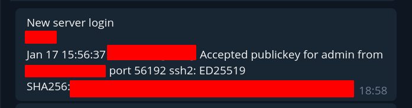
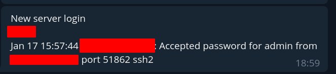
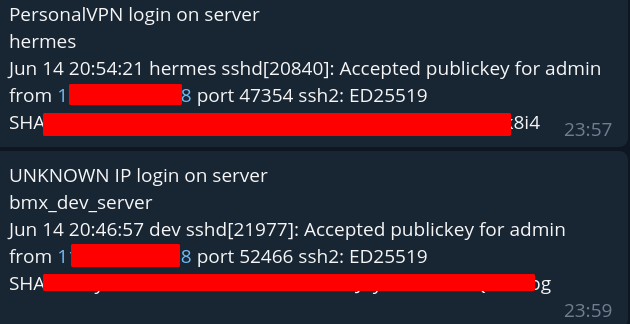

# ssh_notify — SSH login notifications for Telegram and Slack

Get notified when someone logs in to your Linux server over SSH. `ssh_notify` is a small Go service that watches an authentication log and sends successful SSH login alerts to Telegram, Slack, or both.

- Detects successful password and public-key authentication in `sshd` log entries.
- Includes the server name and original log entry in each notification.
- Adds friendly labels for known IPv4 addresses, such as a personal VPN or deployment server.
- Runs as a systemd service and reopens the log after rotation.



<details>
<summary>More notification examples</summary>

Password login:



Known and unknown IP labels:



</details>

## Quick start

You need:

- A Linux server with systemd and a text authentication log containing entries such as `sshd[123]: Accepted publickey for ...`. The default path is `/var/log/auth.log`; set `SSHLogFile` if your system uses another path.
- [Go](https://go.dev/doc/install), Git, and Make to build from source. The module declares Go 1.16; use a maintained Go release.
- Root or sudo access for installation. The supplied service runs as root so it can read the authentication log.
- Credentials for at least one notification destination and outbound HTTPS access to its API.

For Telegram, [create a bot with BotFather](https://core.telegram.org/bots/tutorial#obtain-your-bot-token), start a conversation with it or add it to your target group, and obtain that chat's ID. For Slack, install a bot with the [`chat:write` permission](https://docs.slack.dev/reference/methods/chat.postMessage/) and invite it to the destination channel.

### 1. Build and install the binary

```sh
git clone https://github.com/abergasov/ssh_notify.git
cd ssh_notify
make build
sudo install -m 0755 bin/ssh_notify /usr/bin/ssh_notify
```

To build without Make, replace `make build` with:

```sh
go build -o bin/ssh_notify ./cmd
```

### 2. Configure notifications

For a new installation, copy the template and edit it:

```sh
sudo install -m 0600 ssh_notify.conf /etc/ssh_notify.conf
sudoedit /etc/ssh_notify.conf
```

Replace the template contents with your settings. This example enables only Telegram:

```ini
SSHLogFile = /var/log/auth.log
ServerName = production-web

TelegramBotToken = YOUR_TELEGRAM_BOT_TOKEN
TelegramNotifyChat = YOUR_TELEGRAM_CHAT_ID

SlackBotToken =
SlackTargetChannel =

KnownIps = 203.0.113.10:PersonalVPN;198.51.100.20:DeployServer
```

Replace the example addresses with your own, or leave `KnownIps` empty. Leave both settings for an unused destination empty. End the file with a newline; the current parser skips a final line without one.

### 3. Start the service

```sh
sudo install -m 0644 ssh_notify.service /etc/systemd/system/ssh_notify.service
sudo systemctl daemon-reload
sudo systemctl enable --now ssh_notify.service
sudo systemctl status ssh_notify.service
```

The service sends a startup notification. Once it is running, open a **new SSH connection** to check login notifications. Existing log entries are skipped at startup.

## Configuration

The configuration file is always read from `/etc/ssh_notify.conf`. Settings use `Key = Value` syntax without quotes. Restart the service after editing it.

| Setting | Purpose | Default when omitted |
| --- | --- | --- |
| `SSHLogFile` | Path to the text authentication log | `/var/log/auth.log` |
| `ServerName` | Server label included in notifications | `default_server_name` |
| `TelegramBotToken` | Telegram bot token; requires `TelegramNotifyChat` | Empty |
| `TelegramNotifyChat` | Telegram destination chat ID; requires `TelegramBotToken` | Empty |
| `SlackBotToken` | Slack bot token; requires `SlackTargetChannel` | Empty |
| `SlackTargetChannel` | Slack destination channel ID; requires `SlackBotToken` | Empty |
| `KnownIps` | IPv4 labels in `IP:Name;IP:Name` format | Empty |

Configure both pairs to send to both destinations. An empty pair disables that destination; leaving all four values empty disables notifications.

`KnownIps` changes notification labels only. It does not filter notifications or control SSH access.

## Service management

View recent logs or follow new messages:

```sh
sudo journalctl -u ssh_notify.service -n 50 --no-pager
sudo journalctl -u ssh_notify.service -f
```

Restart after a configuration change:

```sh
sudo systemctl restart ssh_notify.service
```

To update an existing installation, run these commands from the repository directory. Your configuration is preserved:

```sh
git pull --ff-only
make build
sudo systemctl stop ssh_notify.service
sudo install -m 0755 bin/ssh_notify /usr/bin/ssh_notify
sudo systemctl start ssh_notify.service
```

To uninstall, run `make remove` from the repository directory. This stops and disables the service and removes its unit and configuration files. Remove the remaining binary and reload systemd:

```sh
sudo rm /usr/bin/ssh_notify
sudo systemctl daemon-reload
```

## Troubleshooting

| Symptom | What to check |
| --- | --- |
| Service cannot load its configuration | Ensure `/etc/ssh_notify.conf` exists and is readable by the service. |
| Authentication log is missing | Set `SSHLogFile` to the actual text log path. Systems that log only to journald need a text log configured first. |
| Service runs but sends nothing | Replace template placeholders and configure both values for at least one destination. Check the service journal for API errors. |
| Startup notification arrives, but login alerts do not | Open a new SSH connection and check whether it produces a matching `sshd[PID]: Accepted ...` entry in the configured file. |
| Telegram reports an error | Check the bot token, chat ID, and whether the bot can send to that chat. An HTML parsing error can also occur if a server label or log entry contains unescaped markup. |
| Slack reports `invalid_auth`, `channel_not_found`, or `not_in_channel` | Check the bot token, destination channel ID, permissions, and channel membership. |
| Last configuration setting is ignored | Save the configuration with a trailing newline. |
| Known-IP labels are unexpected | Use semicolons between `IPv4:Name` entries. See the parsing limitation below. |

## Behavior and limitations

- Only matching successful SSH authentication entries generate login alerts. Failed attempts, logouts, and journald input are not monitored.
- Existing log entries are skipped on each process start. Entries written while the service is stopped are not replayed.
- Failed notification requests are logged but are not retried or stored for later delivery. In-flight sends can be lost when the process stops.
- Requests have a 10-second timeout. At most eight sends run concurrently; log processing waits for capacity when they are busy.
- Known-IP labels currently use the first IPv4 address found in the entire log entry. IPv6 labels are unsupported, and an earlier address in the line can produce an incorrect label. Check the original log entry to verify the remote address.

## Make installation shortcut

For simple values, the existing Makefile can build the binary, generate the configuration, and install and start the service in one step:

```sh
make name=production-web tg_token=YOUR_TELEGRAM_BOT_TOKEN tg_chat=YOUR_CHAT_ID install
sudo chmod 0600 /etc/ssh_notify.conf
sudo systemctl daemon-reload
sudo systemctl restart ssh_notify.service
```

Run this from the cloned repository directory. Optional variables are `sl_token` (`SlackBotToken`), `sl_chn` (`SlackTargetChannel`), and `ips` (`KnownIps`).

This target overwrites `/etc/ssh_notify.conf`. Its substitutions do not escape shell or sed special characters; use the quick-start configuration file approach for labels with spaces or multiple known IPs. Editing the file also keeps tokens out of shell history.

## Ansible example

<details>
<summary>Deploy from an existing checkout on the managed host</summary>

Install Go and clone the repository on the managed host first. This playbook assumes the checkout is at `/opt/ssh_notify`. Supply `server_name`, `tg_token`, and `tg_chat` in an encrypted `vault.yml` file, and adjust the log path if needed.

```yaml
---
- hosts: servers
  become: true
  vars_files:
    - vault.yml
  tasks:
    - name: Build ssh_notify
      ansible.builtin.command: go build -o bin/ssh_notify ./cmd
      args:
        chdir: /opt/ssh_notify

    - name: Install binary
      ansible.builtin.copy:
        src: /opt/ssh_notify/bin/ssh_notify
        dest: /usr/bin/ssh_notify
        remote_src: true
        owner: root
        group: root
        mode: "0755"
      notify: Restart ssh_notify

    - name: Configure Telegram notifications
      ansible.builtin.copy:
        dest: /etc/ssh_notify.conf
        owner: root
        group: root
        mode: "0600"
        content: |
          SSHLogFile = /var/log/auth.log
          ServerName = {{ server_name }}
          TelegramBotToken = {{ tg_token }}
          TelegramNotifyChat = {{ tg_chat }}
      no_log: true
      notify: Restart ssh_notify

    - name: Install systemd unit
      ansible.builtin.copy:
        src: /opt/ssh_notify/ssh_notify.service
        dest: /etc/systemd/system/ssh_notify.service
        remote_src: true
        owner: root
        group: root
        mode: "0644"
      notify: Restart ssh_notify

    - name: Enable and start service
      ansible.builtin.systemd_service:
        name: ssh_notify.service
        daemon_reload: true
        enabled: true
        state: started

  handlers:
    - name: Restart ssh_notify
      ansible.builtin.systemd_service:
        name: ssh_notify.service
        state: restarted
```

</details>

## Development and support

Run checks from the repository root:

```sh
go test ./...
go test -race ./...
go vet ./...
```

For a bug report, include your OS, Go version, installation method, and relevant service logs in a [GitHub issue](https://github.com/abergasov/ssh_notify/issues). Remove bot tokens and other private details before sharing logs.
